### ◦ intelligence that learns you ◦

---

## ✦ About me

I'm **Aruna Dey**, working at the intersection of **AI and human behaviour**. My work is about building products that understand people: how they act, learn and change, so technology can adapt to them instead of the other way round.

## ✦ What I work on

<table>
<tr>
<td width="50%" valign="top">

### 🟣 [dotsin.ai](https://dotsin.ai)
**Live Limitless with Your Living Twin.**

A behavioural intelligence app. The *Living Twin* learns your habits and guides you as you evolve, across WhatsApp, the app and a Chrome extension, with meeting summaries, goal tracking and a feed ranked by your current state.

</td>
<td width="50%" valign="top">

### 🔵 [Assessli](https://assessli.com)
**An AI-powered companion for learners and educators.**

Automated evaluation and question generation, student progress tracking and batch-level analytics, powered by a *Large Behavioural Model* that profiles learning traits like focus, retention and impulsiveness.

</td>
</tr>
</table>

## ✦ Themes I care about

`Behavioural AI` · `Personalisation` · `Privacy-first design` · `EdTech` · `Learning analytics`

## ✦ Connect

- 🌐 [dotsin.ai](https://dotsin.ai) · [assessli.com](https://assessli.com)
- 🐙 [@ArunaDotisn](https://github.com/ArunaDotisn)

◦ ◦ ◦ &nbsp; made with curiosity &nbsp; ◦ ◦ ◦

